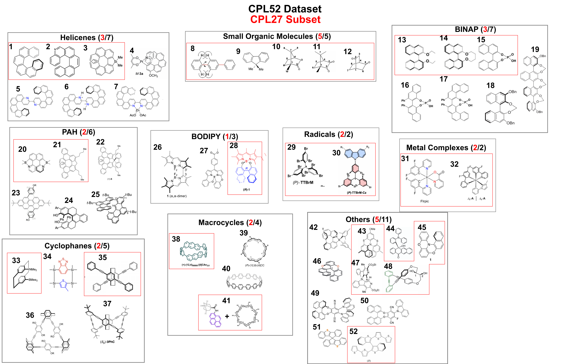

# A Dataset for Luminescence and Circularly Polarized Luminescence Spectra

[](https://creativecommons.org/licenses/by/4.0/)
[](https://git.rwth-aachen.de/bannwarthlab/cpl50)



This project contains: 
- Experimental luminescence (`data/spectra/*LUM.csv`) and CPL (`data/spectra/*CPL.csv`) spectra.
- Molecular structures (`data/structures/*.xyz`) in xyz format.

---
# File Description
Each `.csv` file contains a 1-line header with information about the experiments in the format:

`DOI,molname,T,c,solv,irrad,quant,unit`

with:
- `DOI`: The doi to the article the data was extracted from.

- `molname`: A short description/alias of the respective molecule, typically one that is given in the corresponding article.

- `T`: The temperature (in K) at which the measurements were performed. 
    If none was given/found, `0` is added here. "Room temperature" is always set to 293.15 K.

- `c`: The concentration (in M) at which the measurements were performed.
    If none was given/found, `0` is added here.
- `solv`: A (short) name of the solvent used in the experiments.
    A list of accepted solvents may be found in `src/cpl50/utils.py`.

- `irrad`: The used irradiation wavelength (in nm).
    If none was given/found, `0` is added here.

- `quant`: The experimental quantity measured, e.g. `di` ($\Delta I$) in CPF.

- `unit`: The unit of `quant`, if provided. 
    If none was given/found, or the quantity is dimensionless, `0` is added here.


A valid example header, e.g., for molecule 60 (`data/spectra/60/60_CPL.csv`) looks like this: 

`10.3390/molecules23102606,FL1-C1,293.15,5e-5,meoh,255,di,0`

This refers to the CPL spectrum of FL1-C1 from [this article](10.3390/molecules23102606), measured at room temperature (293.15 K) with a concentration of 5e-5 M in MeOH using $\lambda_\mathrm{irr} = 255~\mathrm{nm}$. The reported intensity is a $\Delta I$.

### Data Format

- CPL spectra: 
```bash
<header>
<wavelength1>, <quant1>
<wavelength2>, <quant2>
...
```
- Molecular geometries: 
```bash
<natoms>
<comment line>
<element1> <x1> <y1> <z1>
<element2> <x2> <y2> <z2>
...
```
All geometries are optimized with the [semiempirical electronic structure theory method GFN2-xTB](https://pubs.acs.org/doi/10.1021/acs.jctc.8b01176) as implemented in the [xtb program](https://github.com/grimme-lab/xtb) (version 6.7.0):
`xtb coord.xyz --opt (--chrg <int> --uhf <int>)`

If molecules are charged or have unpaired electrons in their electronic ground states, this information is contained in the `.CHRG` and `.UHF` files.  

### Further Notes
- Measurements in thin films, matrices, or gels are omitted and deliberately excluded from the dataset at the moment.
- Some geometries were simplified (truncation of flexible alkane chains, tBu -> Me, etc.) to be computationally more tractable, and may differ from the Lewis structures illustrated above.  

### File Names
Systems with more than one molecule carry alphabetic labels. One example is system 33, where we find: 
- `33a_LUM.csv`, the luminescence spectrum of `structures/33a.xyz`
- `33ab_CPL.csv`, the CPL spectrum of a noncovalent complex of `33a.xyz` and `33b.xyz`  

If data for systems measured at different experimental conditions is added, these carry integer suffixes `_<int>`. 
An example is provided in `data/spectra/25`:
- `25_LUM.csv` - measurement in toluene at 293.15 K
- `25_LUM_1.csv` - measurement in toluene at 77 K
etc.

## Running Tests

We provide a small suite of python tests, mostly ensure that additions to the repository are properly formatted and contain all relevant information.  
You can install the dependencies in a virtual environment, and run the tests with `pytest`:
```bash
python3 -m venv .venv 
source .venv/bin/activate
pip install -e ."[test]"
python3 -m pytest tests -v
```

--- 

# Overview of Existing Data

| Index | Reference |
|------|-------|
| 1 |  [(P)-c1](https://pubs.acs.org/doi/full/10.1021/acs.jctc.6b00109) | 
| 2 | (P)-c3 | 
| 3 | [(P)-3](https://pubs.acs.org/doi/10.1021/ol4005036) | 
| 4 | [(M)-3a](https://pubs.rsc.org/en/content/articlepdf/2014/sc/c3sc53442a) | 
| 5 | [(P-P-1)](https://pubs.acs.org/doi/full/10.1021/acs.joc.9b00389) + [Correction](https://pubs.acs.org/doi/10.1021/acs.joc.9b01513) |
| 6 | (P-P)-1*2H^+ 2OTf^- | 
| 7  | (P-P)-1*Zn(OAc)2 | 
| 8 | [Ph3](https://www.mdpi.com/1420-3049/23/10/2606) | 
| 9 | FL1-C1 |
| 10 | [(1R-4R)-1](https://onlinelibrary.wiley.com/doi/epdf/10.1002/chir.22176)
| 11 | (1R)-(4) |
| 12 | (1S-4S)-5 | 
| 13 | [(S)-1](https://doi.org/10.1002/asia.201200725) |
| 14 | (S)-2 | 
| 15 | [(R)-3](https://doi.org/10.1039/C4RA11488D) | 
| 16 | (R)-1 |
| 17 | (R)-2 | 
| 18 | [(R)-1](https://chemistry-europe.onlinelibrary.wiley.com/doi/full/10.1002/chem.201702143) | 
| 19 | (RRR)-2 | 
| 20 | [(M)-1c](https://chemistry-europe.onlinelibrary.wiley.com/doi/full/10.1002/chem.201604398) |
| 21 | [(+)-4](https://pubs.acs.org/doi/full/10.1021/ja300278e) | 
| 22 | (+)-6 | 
| 23 | [(P-P)-8b](https://pubs.acs.org/doi/full/10.1021/jacs.7b06848)
| 24 | [(+)-(M)-1c](https://pubs.acs.org/doi/full/10.1021/acs.joc.7b01087) | 
| 25 | [(p)-(+)-1](https://pubs.acs.org/doi/10.1021/acs.orglett.6b00747) | 
| 26 | [(aS)-1](https://chemistry-europe.onlinelibrary.wiley.com/doi/epdf/10.1002/chem.201602684) | 
| 27 | [(P)-3](https://chemistry-europe.onlinelibrary.wiley.com/doi/epdf/10.1002/cptc.201700106) 
| 28 | [(R)-1](https://pubs.acs.org/doi/full/10.1021/ja412294s) | 
| 29 | [(P)-TTBrM](https://chemistry-europe.onlinelibrary.wiley.com/doi/full/10.1002/chem.202000098) | 
| 30 | [(P)-TTBrM-Cz](https://chemrxiv.org/doi/full/10.26434/chemrxiv.10001626/v1) | 
| 31 | [2](https://www.sciencedirect.com/science/article/pii/S0021967316306501)  | 
| 32 | [delta_Ir-A](https://onlinelibrary.wiley.com/doi/epdf/10.1002/anie.201704263) | 
| 33 | [(+)-Rp](https://pubs.acs.org/doi/full/10.1021/acs.orglett.8b02995) |
| 34 | [(R)-9](https://pubs.acs.org/doi/full/10.1021/jacs.7b05671) |
| 35 | [(Sp)-5](https://chemistry-europe.onlinelibrary.wiley.com/doi/epdf/10.1002/ejoc.201501181)  | 
| 36 | [(Sp)-C3](https://chemistry-europe.onlinelibrary.wiley.com/doi/epdf/10.1002/chem.201402930) |
| 37 | [(Rp)-3PhC](https://pubs.rsc.org/en/content/articlelanding/2015/tc/c4tc02339k) | 
| 38 | [(+)-(12-4)BBBB-[4]CAn2-6](https://onlinelibrary.wiley.com/doi/full/10.1002/ange.201909401) | 
| $^{A}$39 | [(P)-(12-8)-[4]CC](https://www.pnas.org/doi/epdf/10.1073/pnas.1717524114) |
| 40 | [[12]-cpp](https://www.mdpi.com/1420-3049/23/10/2606) | 
| 41 | [ACNP / ACNP@beta-CD](https://pubs.acs.org/doi/full/10.1021/acs.jpclett.1c02013) | 
| 42 | [(P)-4](https://chemistry-europe.onlinelibrary.wiley.com/doi/full/10.1002/chem.201801908)
| 43 | [(M)-2](https://www.sciencedirect.com/science/article/pii/S1010603015004414) | 
| 44 | [(R)-DPHN](https://pubs.rsc.org/en/content/articlepdf/2015/cc/c5cc04105h) | 
| 45 | [(P)-1](https://pubs.acs.org/doi/full/10.1021/acs.joc.7b00511) | 
| 46 | [(-)-1](https://chemistry-europe.onlinelibrary.wiley.com/doi/full/10.1002/chem.201603591) | 
| 47 | [7aa](https://chemistry-europe.onlinelibrary.wiley.com/doi/full/10.1002/chem.201605000) |
| $^{A}$48 | [(1R-2R)-1](https://pubs.rsc.org/en/content/articlehtml/2016/sc/c6sc01808d) |
| 49 | [(R)-1](https://pubs.acs.org/doi/full/10.1021/jacs.6b00850) |
| 50 | [(S)-BN-CF](https://advanced.onlinelibrary.wiley.com/doi/full/10.1002/adfm.201800051) |
| 51 | [(+)-1](https://pubs.acs.org/doi/full/10.1021/acs.orglett.7b02337) | 
| 52 | [(R)-T4-BT2](https://pubs.acs.org/doi/full/10.1021/jp504307v) | 

A: No luminescence spectra available.

---
## How to Cite
> Please see the corresponding publication (N. Maser, M. Pauls, G. Feldmann, C. Bannwarth, *manuscript in preparation*) for additional information.  
---

## Contributors

- [Mike Pauls](pauls@pc.rwth-aachen.de)
- Nicole Maser

---
## How to Contribute

> We encourage you to complement and extend this dataset. To do so, just create an issue on GitLab and ensure that your data passes the tests - that's it! 

