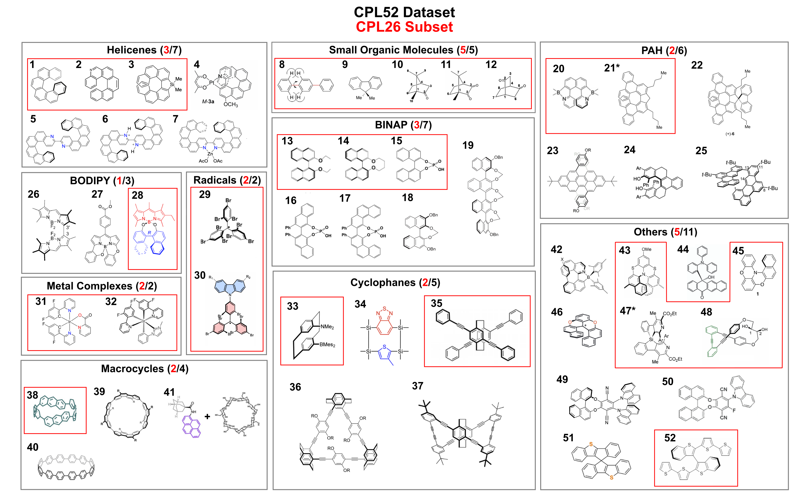

# A Dataset for Luminescence and Circularly Polarized Luminescence Spectra

[](https://creativecommons.org/licenses/by/4.0/)
[](https://git.rwth-aachen.de/bannwarthlab/cpl50)



This project contains: 
- Experimental luminescence (`data/spectra/*LUM.csv`) and CPL (`data/spectra/*CPL.csv`) spectra.
- Molecular structures (`data/structures/*.xyz`) in xyz format.

---
# File Description
Each `.csv` file contains a 1-line header with information about the experiments in the format:

`DOI,molname,T,c,solv,irrad,quant,unit`

with:
- `DOI`: The doi to the article the data was extracted from or presented in.

- `molname`: A short description/alias of the respective molecule, typically one that is given in the corresponding article.

- `T`: The temperature (in K) at which the measurements were performed. 
    If none was given/found, `0` is added here. "Room temperature" refers to 293.15 K.

- `c`: The concentration (in M) at which the measurements were performed.
    If none was given/found, `0` is added here.
- `solv`: A (short) name of the solvent used in the experiments.
    A list of accepted solvents may be found in `src/cpl50/utils.py`.

- `irrad`: The used irradiation wavelength (in nm).
    If none was given/found, `0` is added here.

- `quant`: The experimental quantity measured, e.g. `di` ($\Delta I$) in CPF.

- `unit`: The unit of `quant`, if provided. 
    If none was given/found, or the quantity is dimensionless, `0` is added here.


A valid example header, e.g., for molecule 60 (`data/spectra/9/9_CPL.csv`) looks like this: 

`10.3390/molecules23102606,FL1-C1,293.15,5e-5,meoh,255,di,0`

This refers to the CPL spectrum of FL1-C1 from [this article](10.3390/molecules23102606), measured at room temperature (293.15 K) with a concentration of 5e-5 M in MeOH using $\lambda_\mathrm{irr} = 255~\mathrm{nm}$. The reported intensity is a $\Delta I$.

### Data Format

- CPL spectra: 
```bash
<header>
<wavelength1>, <quant1>
<wavelength2>, <quant2>
...
```
- Molecular geometries: 
```bash
<natoms>
<comment line>
<element1> <x1> <y1> <z1>
<element2> <x2> <y2> <z2>
...
```
All geometries are optimized with the [semiempirical electronic structure theory method GFN2-xTB](https://pubs.acs.org/doi/10.1021/acs.jctc.8b01176) as implemented in the [xtb program](https://github.com/grimme-lab/xtb) (version 6.7.0):
`xtb coord.xyz --opt (--chrg <int> --uhf <int>)`

If molecules are charged or have unpaired electrons in their electronic ground states, this information is contained in the `.CHRG` and `.UHF` files.  

### Further Notes
- Measurements in thin films, matrices, or gels are omitted and deliberately excluded from the dataset at the moment.
- Some geometries were simplified (truncation of flexible alkane chains, tBu -> Me, etc.) to be computationally more tractable, and may differ from the Lewis structures illustrated above.  

### File Names
Systems with more than one molecule carry alphabetic labels. One example is system 33, where we find: 
- `33a_LUM.csv`, the luminescence spectrum of `structures/33a.xyz`
- `33ab_CPL.csv`, the CPL spectrum of a noncovalent complex of `33a.xyz` and `33b.xyz`  

If data for systems measured at different experimental conditions is added, these carry integer suffixes `_<int>`. 
An example is provided in `data/spectra/25`:
- `25_LUM.csv` - measurement in toluene at 293.15 K
- `25_LUM_1.csv` - measurement in toluene at 77 K
etc.

## Running Tests

The test suite has two parts: 
- dataset tests check that every spectrum parses with a valid header (DOI, solvent, units, file naming) and that every structure is a well-formed
- library tests check the spectroscopic code against analytic limits and sum rules (e.g. $\int\varepsilon\,d\tilde\nu \propto f$, $\Delta\varepsilon/\varepsilon = 4R/D$, recovery of known energy shifts). 

The dataset tests loop over all files in `data/`, so new data can added by dropping `.csv` and `.xyz` files into the existing folder structure; the CI pipeline then validates it automatically, so contributions from theorists and experimentalists alike need no changes to the code.

You can install the dependencies in a virtual environment, and run the tests with `pytest`:
```bash
python3 -m venv .venv 
source .venv/bin/activate
pip install -e ".[dev]"   # pulls tcgm_unitkit from gitlab.git.nrw
python3 -m pytest tests -v
```

--- 

# Overview of Existing Data

An overview of all systems in the dataset and their literature references is given in the documentation (`docs/`, page *Overview of Existing Data*).

---
## How to Cite
> Please see the corresponding publication (N. Maser, M. Pauls, G. Feldmann, C. Bannwarth, *manuscript in preparation*) for additional information.  
---

## Contributors

- [Mike Pauls](pauls@pc.rwth-aachen.de)
- Nicole Maser

---
## How to Contribute

> We encourage you to complement and extend this dataset. To do so, just create an issue on GitLab and ensure that your data passes the tests - that's it! 

