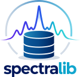

# A Dataset for Luminescence and Circularly Polarized Luminescence Spectra

<!-- gitlab.git.nrw requires a login for /-/badges/*.svg. The coverage badge is rendered by the
     pipeline and published with the docs (.gitlab/coverage_badge.py). -->

[](https://gitlab.git.nrw/rwth-bannwarthlab/cpl50/-/pipelines)

[](https://rwth-bannwarthlab.pages.git.nrw/cpl50)
[](https://creativecommons.org/licenses/by-sa/4.0/)
[](https://gitlab.git.nrw/rwth-bannwarthlab/cpl50)


This project contains: 
- Experimental luminescence (`data/spectra/*LUM.csv`) and CPL (`data/spectra/*CPL.csv`) spectra.
- Molecular structures (`data/structures/*.xyz`) in xyz format.

Documentation available at <https://rwth-bannwarthlab.pages.git.nrw/cpl50>

---
# Quick Start

Install [Miniforge](https://conda-forge.org/download/) (or use an existing Anaconda installation), then:

```bash
git clone https://gitlab.git.nrw/rwth-bannwarthlab/cpl50.git
cd cpl50
conda env create -f environment.yml
conda activate spectralib
pytest tests -m dataset              # validate the dataset
```

```python
from spectralib import read_spectrum

spec = read_spectrum("data/spectra/9/9_CPL.csv")   # x in nm, y, and the header as spec.metadata
print(spec.metadata["molname"], spec.metadata["DOI"])
```

More in the documentation:
- [Installation](https://rwth-bannwarthlab.pages.git.nrw/cpl50/installation.html) (pip, uv, Anaconda Navigator, platform support)
- [File Description](https://rwth-bannwarthlab.pages.git.nrw/cpl50/dataset.html) (header format, file names, accepted solvents)
- [Overview of Existing Data](https://rwth-bannwarthlab.pages.git.nrw/cpl50/data.html)
- [Running Tests](https://rwth-bannwarthlab.pages.git.nrw/cpl50/testing.html)

---
## How to Cite
> Please see the corresponding publication (N. Maser, M. Pauls, G. Feldmann, C. Bannwarth, *manuscript in preparation*) for additional information.  
---

## Contributors

- [Mike Pauls](mailto:pauls@pc.rwth-aachen.de)
- Nicole Maser

---
## How to Contribute

> We encourage you to complement and extend this dataset. To do so, just create an issue on GitLab and ensure that your data passes the tests - that's it! 
