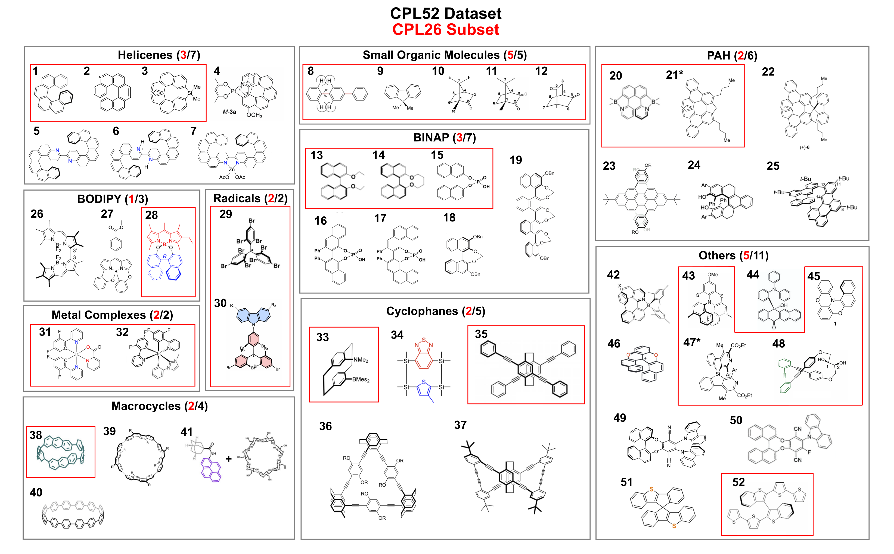

Overview of Existing Data
=========================

The table lists all systems in the dataset together with the article the spectra were taken from.

.. list-table::
   :header-rows: 1
   :widths: 12 38 50

   * - Index
     - Molecule
     - Reference
   * - 1
     - (P)-c1
     - :cite:`liuVibronicCouplingExplains2016a`
   * - 2
     - (P)-c3
     - :cite:`liuVibronicCouplingExplains2016a`
   * - 3
     - (P)-3
     - :cite:`oyamaFacileSyntheticRoute2013a`
   * - 4
     - (M)-3a
     - :cite:`shenStraightforwardAccessMono2014`
   * - 5
     - (P-P)-1
     - :cite:`islaBis4aza6heliceneBishelicenic22Bipyridine2019,islaCorrectionBis4aza6helicene2019`
   * - 6
     - (P-P)-1\*2H^+ 2OTf^-
     - :cite:`islaBis4aza6heliceneBishelicenic22Bipyridine2019`
   * - 7
     - (P-P)-1\*Zn(OAc)2
     - :cite:`islaBis4aza6heliceneBishelicenic22Bipyridine2019`
   * - 8
     - Ph3
     - :cite:`fujikiQuestionsMirrorSymmetry2018`
   * - 9
     - FL1-C1
     - :cite:`fujikiQuestionsMirrorSymmetry2018`
   * - 10
     - (1R-4R)-1
     - :cite:`longhiExperimentalCalculatedCPL2013a`
   * - 11
     - (1R)-(4)
     - :cite:`longhiExperimentalCalculatedCPL2013a`
   * - 12
     - (1S-4S)-5
     - :cite:`longhiExperimentalCalculatedCPL2013a`
   * - 13
     - (S)-1
     - :cite:`kimotoControlCircularlyPolarized2012`
   * - 14
     - (S)-2
     - :cite:`kimotoControlCircularlyPolarized2012`
   * - 15
     - (R)-3
     - :cite:`kitayamaCircularlyPolarizedLuminescence2014`
   * - 16
     - (R)-1
     - :cite:`kitayamaCircularlyPolarizedLuminescence2014`
   * - 17
     - (R)-2
     - :cite:`kitayamaCircularlyPolarizedLuminescence2014`
   * - 18
     - (R)-1
     - :cite:`takaishiHelicalOligonaphthodioxepinsShowing2017`
   * - 19
     - (RRR)-2
     - :cite:`takaishiHelicalOligonaphthodioxepinsShowing2017`
   * - 20
     - (M)-1c
     - :cite:`shenSynthesisChiropticalProperties2017`
   * - 21
     - (+)-4
     - :cite:`sawadaRhodiumCatalyzedEnantioselectiveSynthesis2012`
   * - 22
     - (+)-6
     - :cite:`sawadaRhodiumCatalyzedEnantioselectiveSynthesis2012`
   * - 23
     - (P-P)-8b
     - :cite:`yangChiralPeropyreneSynthesis2017`
   * - 24
     - (+)-(M)-1c
     - :cite:`fangSynthesisStructuresPhotophysical2017`
   * - 25
     - (p)-(+)-1
     - :cite:`uchidaSynthesisPhotophysicalProperties2016`
   * - 26
     - (aS)-1
     - :cite:`zinnaCircularlyPolarizedLuminescence2016`
   * - 27
     - (P)-3
     - :cite:`clarkeCircularlyPolarisedLuminescence2017`
   * - 28
     - (R)-1
     - :cite:`sanchez-carnereroCircularlyPolarizedLuminescence2014`
   * - 29
     - (P)-TTBrM
     - :cite:`mayorga-burrezoEnantiopurePropellerLikeTritylBrominated2020`
   * - 30
     - (P)-TTBrM-Cz
     - :cite:`schoneburgHighlyLuminescentCarbazolefunctionalized`
   * - 31
     - 2
     - :cite:`cittiAnalyticalPreparativeEnantioseparation2016`
   * - 32
     - delta_Ir-A
     - :cite:`hellouEnantiopureCycloiridiatedComplexes2017`
   * - 33
     - (+)-Rp
     - :cite:`zhangSolidStateEmissiveTriarylboraneBased2018`
   * - 34
     - (R)-9
     - :cite:`shimadaMultifunctionalOctamethyltetrasila22cyclophanesConformational2017`
   * - 35
     - (Sp)-5
     - :cite:`gonHighlyEmissiveOptically2015`
   * - 36
     - (Sp)-C3
     - :cite:`morisakiPlanarChiralThroughSpaceConjugated2014`
   * - 37
     - (Rp)-3PhC
     - :cite:`gonOpticallyActiveCyclic2014`
   * - 38
     - (+)-(12-4)BBBB-[4]CAn2-6
     - :cite:`ange201909401`
   * - 39\ :sup:`A`
     - (P)-(12-8)-[4]CC
     - :cite:`satoChiralIntertwinedSpirals2017`
   * - 40
     - [12]-cpp
     - :cite:`fujikiQuestionsMirrorSymmetry2018`
   * - 41
     - ACNP / ACNP\@beta-CD
     - :cite:`yangSelfAssemblyCircularlyPolarized2021`
   * - 42
     - (P)-4
     - :cite:`dominguezAzabora5heliceneChargeTransferDyes2018`
   * - 43
     - (M)-2
     - :cite:`longhiChiropticalPropertiesGround2016a`
   * - 44
     - (R)-DPHN
     - :cite:`imagawaThermallyActivatedDelayed2015`
   * - 45
     - (P)-1
     - :cite:`nishimuraOxygenBridgedDiphenylnaphthylamineScaffold2017a`
   * - 46
     - (-)-1
     - :cite:`bossonPhysicochemicalElectronicProperties2016`
   * - 47
     - 7aa
     - :cite:`shintaniRhodiumCatalyzedSynthesisOptical2017`
   * - 48\ :sup:`A`
     - (1R-2R)-1
     - :cite:`p.morcilloStapledHelicalOPE2016`
   * - 49
     - (R)-1
     - :cite:`feuillastreDesignSynthesisNew2016`
   * - 50
     - (S)-BN-CF
     - :cite:`songHighlyEfficientCircularly2018`
   * - 51
     - (+)-1
     - :cite:`takaseCircularlyPolarizedLuminescence2017`
   * - 52
     - (R)-T4-BT2
     - :cite:`longhiStructuralOpticalProperties2014`

:sup:`A` No luminescence spectrum available.
:sup:`*` Truncated geometry, see below.

Structures
----------

   Lewis structures of systems 1–52 as of spectralib version 0.0.2. Red frames mark the 26-system subset.
   The figure is not updated automatically: systems added after version 0.0.2 appear only in the table above.
