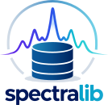

spectralib: A Dataset for Luminescence and Circularly Polarized Luminescence Spectra
====================================================================================

This project contains:

.. list-table::
   :header-rows: 1
   :widths: 60 40

   * - Quantity
     - Location
   * - Experimental luminescence spectra
     - ``data/spectra/<id>/<id>_LUM.csv``
   * - Experimental CPL spectra
     - ``data/spectra/<id>/<id>_CPL.csv``
   * - Molecular structures (xyz format)
     - ``data/structures/<id>/<id>.xyz``
   * - ``spectralib``, a small Python library to read and validate the data, broaden stick spectra and compare
       calculated with experimental spectra
     - ``src/spectralib/``

The source code and the dataset are hosted at `gitlab.git.nrw/rwth-bannwarthlab/cpl50
<https://gitlab.git.nrw/rwth-bannwarthlab/cpl50>`__.

Quick Start
-----------

.. code-block:: bash

   git clone https://gitlab.git.nrw/rwth-bannwarthlab/cpl50.git
   cd cpl50
   conda env create -f environment.yml
   conda activate spectralib

.. code-block:: python

   from spectralib import read_spectrum
   from spectralib.dataset import summarize_dataset
   from spectralib.plotting import plot_spectrum

   summarize_dataset("data/spectra")                  # all spectra with their header information
   spec = read_spectrum("data/spectra/9/9_CPL.csv")   # x in nm, y, and the header as spec.metadata
   print(spec.metadata["molname"], spec.metadata["DOI"])
   plot_spectrum(spec.convert_x("ev", jacobian=True))

See :doc:`installation` for pip, uv and Anaconda Navigator, and :doc:`dataset` for the file format.

.. toctree::
   :maxdepth: 2
   :caption: Contents:

   installation
   dataset
   data
   usage
   testing
   code
   references

How to Cite
-----------

Please see the corresponding publication (N. Maser, M. Pauls, G. Feldmann, C. Bannwarth, *manuscript in preparation*)
for additional information.

How to Contribute
-----------------

We encourage you to complement and extend this dataset. To do so, just create an issue on
`GitLab <https://gitlab.git.nrw/rwth-bannwarthlab/cpl50/-/issues>`__ and ensure that your data passes the tests
(:doc:`testing`) - that's it!

Indices and Tables
------------------

* :ref:`genindex`
* :ref:`modindex`
* :ref:`search`
